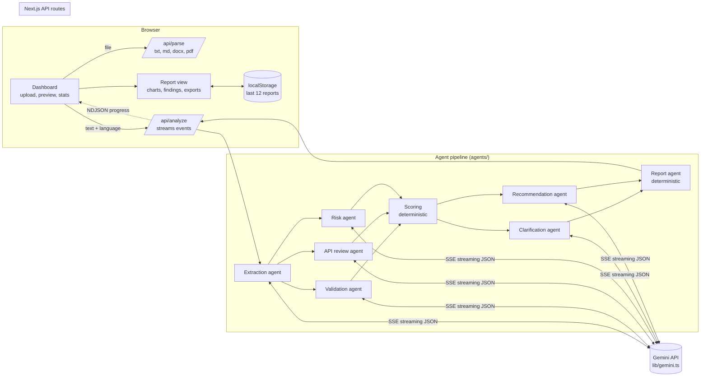

# ReqWise

Catch mistakes in your requirements before they become bugs.

ReqWise reads a requirements document (Word, PDF, text or Markdown, in English or Russian), checks it against **ISO/IEC/IEEE 29148:2018** and **IEEE 830-1998** with a team of AI agents, and produces a clear report: every problem with a quote, an explanation and a suggested fix, plus a score out of 100. The whole interface can be switched between **English and Russian**.


> Screenshot placeholders: capture them after the first run (see `docs/screenshots/README.md`).

---

## What it does

| Area | Details |
|---|---|
| Detects | Ambiguous, missing, inconsistent and non-testable requirements; weak acceptance criteria; missing edge cases; security gaps; performance, data-validation and API-specification issues |
| Clarifying questions | A dedicated agent asks the questions the spec's author must answer, with suggested answers. Answer them in the report and press **Re-check with my answers**: the answers are added to the document and every check runs again |
| Agents | Extraction → Validation, API review and Risk (in parallel) → Clarification and Recommendation (in parallel) → Report |
| Report | 11 sections: summary, clarifying questions, document overview, problems at a glance, quality issues, API issues, security issues, missing requirements, edge cases, suggested fixes, final score, plus an audit trail |
| Scores | Overall 0-100, six dimensions (completeness, clarity, testability, consistency, security, performance), risk score, AI confidence |
| Charts | Radar (dimensions), donut (severity), bars (categories), trend (your analyses over time) |
| Export | PDF (print-quality, selectable text, Cyrillic-safe), Markdown, JSON |
| Languages | Interface in English or Russian (EN / RU switch in the header, remembered in a cookie). Documents and reports in English or Russian; the report language follows the interface language unless you pick another |
| Extras | Explain-decision view per finding, duplicate detection, dependency mapping, smart rewrites with Given/When/Then criteria, sample documents, report history |

---

## Requirements

- **Node.js 20 LTS** (18.18 or newer works)
- A free **Gemini API key** from [Google AI Studio](https://aistudio.google.com/apikey)

Runs comfortably on a laptop with 8 GB RAM: no database, no local model, nine runtime dependencies.

## Installation

```bash
git clone <your-repo-url> reqwise
cd reqwise
npm install
```

## Environment setup

Copy the example file and add your key.

```bash
# macOS / Linux
cp .env.example .env.local

# Windows PowerShell
Copy-Item .env.example .env.local

# Windows cmd
copy .env.example .env.local
```

```env
GEMINI_API_KEY=your-key-here

# Optional
GEMINI_MODEL=gemini-2.5-flash
GEMINI_FALLBACK_MODELS=gemini-3.8-flash,gemini-3.5-flash-lite
```

Next.js loads `.env.local` automatically, so no `dotenv` package is needed. The key is only read on the server and is never sent to the browser.

**About the model.** The challenge specifies Gemini 2.5 Flash, so it is the default. Google now limits `gemini-2.5-flash` to projects that used it before and recommends newer Flash models for new projects. If your key gets "model not found", the app automatically falls back to the models in `GEMINI_FALLBACK_MODELS`, remembers the one that works, and records the model used in the report's audit trail. Free-tier rate limits vary by model and account; check yours in Google AI Studio.

## Running locally

```bash
npm run dev
```

Open http://localhost:3000.

1. Use the **EN / RU** switch in the header to pick the interface language.
2. Choose **Check a document**.
3. Upload a document, paste text, or choose **English sample** / **Russian sample**.
4. Check the report language and select **Check document**. Progress appears as each step finishes.
5. The report opens automatically. Use **Download PDF**, **Markdown** or **JSON**.

**See an example report** works without an API key, in both languages.

## Run the agent from the terminal

The same agents also run from the command line, with no web server and no browser. This is the command for a repeatable run:

```bash
npm install
npm run agent -- --input public/samples/spending-limit-srs-ru.md --output report.md --lang ru
```

| Option | Meaning |
|---|---|
| `-i`, `--input` | Requirements document: `.md`, `.txt`, `.docx` or `.pdf` (required) |
| `-o`, `--output` | Report file. `.json` gives the full structured report; anything else gives Markdown (default `report.md`) |
| `-l`, `--lang` | Report language, `ru` or `en` (default: the document's language) |
| `-h`, `--help` | Show help |

The key is read from `GEMINI_API_KEY`: put it in `.env.local` (see Environment setup) or set it for one run:

```bash
# macOS / Linux
GEMINI_API_KEY=your-key npm run agent -- --input public/samples/spending-limit-srs-ru.md --output report.md

# Windows PowerShell
$env:GEMINI_API_KEY="your-key"; npm run agent -- --input public/samples/spending-limit-srs-ru.md --output report.md
```

The terminal shows each agent as it finishes, then the quality score, the number of problems and clarifying questions, and the path of the saved report. The exit code is `0` on success and `1` on any error, so the command can be used in scripts.

### Tips for an 8 GB machine

- `npm run dev` uses Turbopack, which compiles faster and lighter than webpack. If it misbehaves, `npm run dev:webpack` uses webpack instead.
- For a demo or judging session, run the production server, which uses far less memory than dev mode:
  ```bash
  npm run build
  npm start
  ```
- Close other heavy apps (Ollama models, Docker) while running the dev server.
- If Node runs out of memory, cap its heap: PowerShell `$env:NODE_OPTIONS="--max-old-space-size=2048"` or cmd `set NODE_OPTIONS=--max-old-space-size=2048`, then start again.

### Useful scripts

| Script | Purpose |
|---|---|
| `npm run dev` | Development server (Turbopack) |
| `npm run build` | Production build, includes type checking |
| `npm start` | Run the production build |
| `npm run agent -- --input <file> --output <report>` | Run the agent from the terminal (no web server) |
| `npm run typecheck` | TypeScript check only |

## Deployment (Vercel)

1. Push the project to GitHub.
2. In Vercel, choose **Add New → Project** and import the repository. The Next.js preset is detected automatically.
3. Under **Environment Variables**, add `GEMINI_API_KEY` (and optionally `GEMINI_MODEL`, `GEMINI_FALLBACK_MODELS`).
4. Deploy.

`/api/analyze` sets `maxDuration = 300` seconds, which needs Vercel's Fluid compute (on by default for new projects). If your project has Fluid compute turned off, lower `maxDuration` in `app/api/analyze/route.ts` to `60`.

---

## Architecture



### Pipeline

| Step | Agent | Calls Gemini | Output |
|---|---|---|---|
| 1 | `ExtractionAgent` | yes | Atomic, numbered requirements (`REQ-001…`) with type, priority, section, dependencies, acceptance criteria; API endpoints |
| 2 | `ValidationAgent` | yes, in parallel | Findings for ambiguity, completeness, consistency, correctness, testability, acceptance criteria, edge cases, traceability, feasibility, necessity, duplicates, data validation, performance; missing requirements; edge cases |
| 3 | `ApiReviewAgent` | yes, in parallel, skipped when the document has no API | Status codes, schemas, validation, authentication and authorization, contract clarity |
| 4 | `RiskAgent` | yes, in parallel | Security, privacy, compliance, scalability, performance risks; missing controls |
| 5a | `ClarificationAgent` | yes, in parallel with 5b | Prioritised questions for the spec's author: who should answer, why it matters, suggested answers, linked requirements and findings |
| 5b | `RecommendationAgent` | yes | Rewritten requirements with Given/When/Then criteria; executive summary |
| 6 | `ReportAgent` | **no** | Merges and de-duplicates findings, drops low-confidence noise, scores, detects duplicate requirements, assembles the report |

Every agent file exports an **input schema**, an **output schema** (Zod), a **prompt template** (`build…Prompt`) and an **execution function** (`run…Agent`). The report agent's template is the fixed section outline shared by the screen view and all exports.

At most six model calls per check (five without an API section), which keeps you inside the free tier.

**Clarification loop.** Answers typed in the report are saved in the browser. **Re-check with my answers** appends them to the document as a "Clarifications" section (using the document's own requirement labels) and runs the full pipeline again, so answered questions disappear and the score reflects the clarified specification.

### Design decisions

- **Scores are computed in code, not by the model.** The model finds and explains issues; `lib/scoring.ts` turns them into numbers. Identical findings always give identical scores, and the report shows which findings caused each deduction.
  - penalty = severity weight (critical 20, high 12, medium 6, low 2) × confidence × dimension share
  - dimension score = 100 × e^(−penalties / K), where K = 45 + 1.5 × requirement count
  - overall = weighted mean (completeness, clarity, testability 20% each; consistency, security 15% each; performance 10%)
- **Closed list of standard clauses.** Agents may only cite clauses from `lib/standards.ts`, so references are real.
- **Forgiving output parsing.** Zod schemas normalise enum synonyms ("Ambiguous" → `ambiguity`), accept confidence as 0-1 or 0-100, drop invalid items instead of failing the whole response, and remove requirement IDs the model invented.
- **Resilient Gemini client** (`lib/gemini.ts`): SSE streaming with live progress, JSON mode, private reasoning (thinking) that is never returned, one JSON-repair retry, retries for overload and network errors, a rate-limit retry that honours Google's retry hint, and automatic model fallback.
- **Prompt-injection guard.** Document text is wrapped in `<document>` tags and every system prompt says it is data, not instructions.
- **Graceful degradation.** If validation, API or risk analysis fails, the report is still produced with a note; if the recommendation agent fails, a deterministic summary is used.

### Kept lean on purpose

The brief listed several libraries. Each was replaced where a lighter option does the job better on modest hardware:

| Brief | Used instead | Why |
|---|---|---|
| Recharts | Hand-built SVG charts (`components/charts`) | No dependency, small bundle, full control of accessibility |
| Framer Motion | CSS animations | One orchestrated hero animation; respects reduced motion |
| shadcn/ui + Radix | Two shadcn-style primitives (`components/ui`) | Same look, no extra packages |
| html-to-pdf / pdf-lib | Browser print to PDF | Selectable text and correct Cyrillic; pdf-lib's built-in fonts cannot render Russian |
| react-markdown | Not needed | The report renders from structured JSON; Markdown is an export format |
| Gemini SDK | REST + SSE in `lib/gemini.ts` | Zero dependencies and no SDK version drift |
| Prisma + SQLite | localStorage | No database to install; the brief allowed it |

Glass effects use translucency without blur on cards (blur is costly on integrated GPUs); only the sticky header is blurred.

---

## Project structure

```
app/
  layout.tsx              Fonts, metadata, reads the interface language cookie
  globals.css             Tailwind v4 theme tokens, print styles
  page.tsx                Landing page
  dashboard/page.tsx      Dashboard
  report/[id]/page.tsx    Report ("sample" and "sample-ru" open the example reports)
  api/parse/route.ts      Document upload → text + statistics
  api/analyze/route.ts    Runs the pipeline, streams NDJSON events
  api/status/route.ts     Whether a Gemini key is configured
agents/
  ExtractionAgent.ts  ValidationAgent.ts  ApiReviewAgent.ts
  RiskAgent.ts  ClarificationAgent.ts  RecommendationAgent.ts  ReportAgent.ts
  pipeline.ts             Orchestration, audit trail, progress events
  shared.ts               Shared prompt rules and formatters
components/
  language-provider.tsx   Interface language state (useUi hook)
  language-switch.tsx     EN / RU switch in the header
  landing/  dashboard/  report/  charts/  ui/
hooks/
  use-analysis.ts         Reads the NDJSON stream into UI state
  use-reports.ts          Report history from localStorage
lib/
  gemini.ts               Gemini client
  clarifications.ts       Answers → document → re-check helpers
  schemas.ts              Zod schemas
  scoring.ts              Deterministic scoring
  duplicates.ts           Duplicate requirement detection
  document-parser.ts      TXT/MD (UTF-8 and Windows-1251), DOCX, PDF
  document-stats.ts       Word, requirement, section and endpoint counts
  ui-strings.ts           All interface text in English and Russian
  ui-language.ts          Interface language cookie helpers
  server-language.ts      Reads the language on the server
  i18n.ts                 Report vocabulary in English and Russian
  report-markdown.ts      Markdown export
  standards.ts            Citable clauses
  storage.ts              localStorage history
  sample-report.ts        Example reports in English and Russian
scripts/run-agent.ts      Command-line runner (npm run agent)
types/index.ts            Shared types
public/samples/           Sample specifications (English and Russian)
```

## Troubleshooting

| Message | Fix |
|---|---|
| "GEMINI_API_KEY is not set" | Create `.env.local` with the key and restart `npm run dev` |
| "None of the configured models are available" | Open Google AI Studio, find a Flash model your key can use, set `GEMINI_MODEL` to it |
| "Gemini rate limit reached" | Free-tier per-minute or daily quota. Wait a minute; daily quotas reset at midnight Pacific time |
| "No selectable text was found in this PDF" | The PDF is a scanned image. Export it with OCR or upload a DOCX |
| Report missing after reopening the browser | Reports are stored per browser. Export JSON or Markdown to keep them |
| Want to translate the interface text | Edit `lib/ui-strings.ts` (interface) and `lib/i18n.ts` (reports); both languages sit side by side |

## License

MIT
